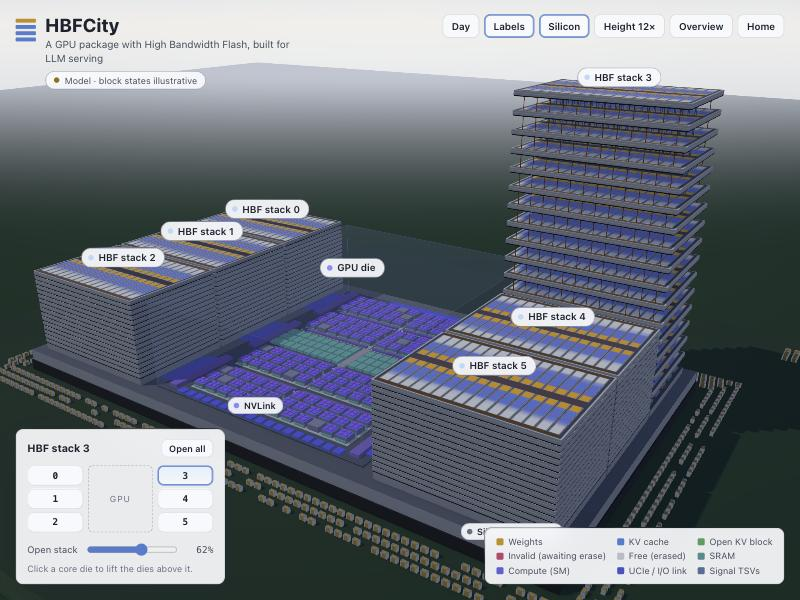
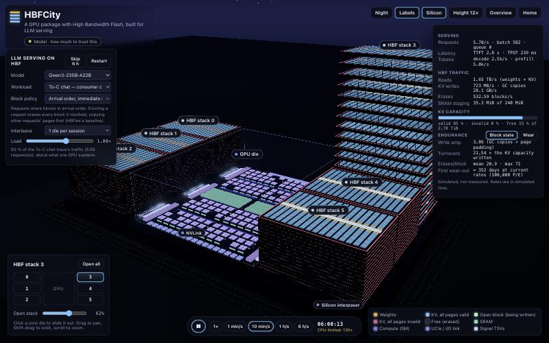
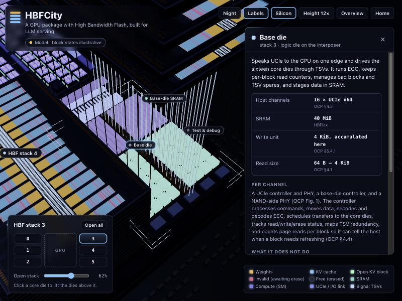

# HBFCity

**A GPU package with High Bandwidth Flash, drawn as a city you can open up.**

An explorable 3D model of an H200-class GPU and six HBF stacks on a silicon
interposer. Each stack is a base (logic) die and sixteen NAND core dies joined
by TSVs; open a stack to see its layers, slide a die out to see all 32 planes
and 16,384 blocks, or lift the core dies to see the base die's UCIe PHYs,
channel controllers and SRAM.


A serving simulator runs underneath: synthetic LLM sessions drawn from
production trace statistics are batched on the GPU, their KV cache is written
to HBF block by block, evicted, reclaimed and erased, and every one of the
1.57 million blocks on the package shows its live state or its wear.

**中文说明**：把一颗带 HBF 的 GPU 封装做成可探索的 3D 城市。中间是 GPU（主动面朝上画），两侧各三个 HBF 堆叠；每个堆叠是一个 base die 加 16 层 NAND core die，用 TSV 连起来。可以把堆叠拆开看分层，把某一层 die 像抽屉一样拉出来看 32 个 plane、16,384 个 block，或把 core die 整体抬起来看 base die 上的 UCIe PHY、通道控制器和 SRAM。底下跑着一个 LLM serving 仿真：按生产 trace 的统计生成会话，做连续批处理，KV 按块写进 HBF、淘汰、回收、擦除；每个 block 实时显示状态或磨损。

| | |
|---|---|
|  |  |
|  |  |
|  |  |

## Run it

```bash
npm install --legacy-peer-deps
npm run dev      # http://127.0.0.1:5181
```

```bash
npm test
npm run typecheck
npm run build    # static bundle in dist/
```

URL parameters for review and screenshots: `theme=day|night`,
`view=overview|stack`, `stack=0..5`, `open=0..1`, `die=0..15`,
`select=<component id>`, `focus=<component id>`, `scale=1..12`, `labels=0|1`,
`model=deepseek-v3|qwen3-235b|hunyuan3`, `workload=toC|toB|coding|thinking`,
`policy=hbflex|arrival`, `width=1|4|16`, `load=<multiplier>`, `speed=<sim s
per s>`, `play=0|1`, `skip=<hours to simulate before the first frame>`,
`blocks=state|wear`, and `settle=1` to skip animations.

## Controls

| Input | Action |
|---|---|
| Drag | Pan |
| Shift-drag, Ctrl-drag or right-drag | Orbit |
| Wheel | Zoom toward the cursor |
| Click | Select (a core die slides out; a base-die part lifts the core dies) |
| Double-click | Focus the camera |
| `X` / `A` | Open or close the selected stack / all stacks |
| `1`–`6` | Go to stack 0–5 |
| `Space` | Play or pause the simulation |
| `W` | Block state / wear view |
| `H` / `O` | Home view / top-down overview |
| `N` / `L` / `B` / `T` | Night–day / labels / GPU bulk silicon / true proportions |
| `Esc` | Deselect |

## Where the numbers come from

Every device number lives in `src/core/hbf-spec.ts` with its source, and the
inspector prints the source next to each fact.

| Quantity | Value | Source |
|---|---|---|
| Stacks per GPU | 6 | HBFlex (arXiv 2609.18675) |
| Core dies per stack | 16 | OCP HBF spec v0.7.0 §4.1 |
| Host channels per stack | 16 × UCIe x64, 32 GT/s | OCP §4.5, Table 2 |
| Link bandwidth | 3,072 GB/s per stack (75 % AXI efficiency) | OCP Table 2 |
| Footprint, height | ≈ 10.975 × 16 mm, 775 µm | OCP §10.3 |
| Planes × blocks × pages × page | 32 × 512 × 512 × 4 KiB → 512 GiB/stack | HBFlex; page size OCP §4.1 |
| tR, tPROG | 4 µs, 75 µs | HBFlex |
| Base-die SRAM | 40 MiB | HBFlex |
| Array-limited read | 512 planes × 4 KiB / 4 µs ≈ 524 GB/s | derived |

Floor plans inside the stack are not public. The core die follows the
published diagrams (FlashAccel Fig. 6c; "HBF Sucks" Fig. 2): signal TSVs in a
centre strip, power TSVs along the long edges, planes in two rows. The base
die follows OCP Fig. 1 functionally. The GPU follows the GH100 block diagram
and is approximate.

## The serving simulator

`src/sim/` has no three.js in it. Each iteration decodes one token for every
running request and prefills up to 2,048 prompt tokens. Its time is the
slowest of compute (2 × active parameters × tokens at half of H200's FP8 peak)
and, for each interleave domain, the reads of its share of the weights and of
its sessions' KV, its KV programs, and leftover garbage-collection work.

| Piece | What it does | Source |
|---|---|---|
| Models | DeepSeek-V3, Qwen3-235B-A22B, Hunyuan3; FP8 weights and KV rebuilt from their public configs (35,136 / 96,256 / 163,840 KV bytes per token) | Hugging Face configs |
| Workload | Synthetic sessions from the quantiles of four 2-hour production traces: To-C chat, To-B API, Coding, Thinking. Default load is the share one GPU sustains | Qwen-Bailian traces, Wang et al., ATC 2025 |
| Writes | KV collects in base-die SRAM and is programmed a stripe at a time; a block index is used on all 32 planes of a die together | OCP §5.4, §11.2.2 |
| Eviction | Least-recently-used sessions are evicted when valid KV passes 90 % of capacity, down to 85 % | — |
| Policies | **Arrival order, immediate reclaim** (HBFlex's baseline) and **HBFlex lifetime packing, delayed reclaim** | HBFlex |

Nothing here does wear leveling: free blocks are taken in queue order. The
wear view and the "first wear-out" projection show what that costs.

Simplifications that matter: experts are routed uniformly; a session's KV
lives on one interleave domain (1, 4 or 16 dies); prefix reuse follows a
session's turns, not hashes across sessions; GC copies stay in their domain
when there is room. At high playback speed the loop advances many identical
iterations per step, so latency is coarser but every byte written and every
erase is still counted.

## How much to trust this

- It is a model, not a die photo. Unpublished layouts are marked in the inspector.
- Heights are exaggerated 12× by default (`T` shows true proportions); circuit
  blocks are raised for legibility; opening a stack and sliding a die out are
  viewing aids.
- The GPU is drawn active side up; on a real package it is flip-chip mounted
  face down. Its bulk silicon is a translucent volume as tall as the stacks.
- OCP Table 3 counts 16 banks per channel; this model uses HBFlex's 32 planes
  per die. One host channel per die follows OCP §4.3; OCP Fig. 4 shows another
  arrangement.
- Block colours come from the simulator, not from a measurement, and its
  block unit is coarser than HBFlex's per-plane blocks, so its write
  amplification is not HBFlex's published number.

## How it is built

```text
src/
  core/    contracts, bus, registry, theme, HBF spec table
  sim/     models, workload, KV store and policies, serving loop (no three.js)
  world/   package, GPU, HBF stacks, die floor-plan shader, block atlas,
           sim view (store -> atlas), activity, flow pulses, sky
  engine/  renderer, camera, labels, picking
  ui/      HUD, inspector, simulation panels, sourced notes
test/      arithmetic, geometry, atlas, store invariants and serving tests
```

Stack: three.js r185, TypeScript, Vite. three.js is the only runtime
dependency. The world reads `SceneState`; the UI edits it and talks over the
bus. All 96 core dies are one instanced draw; their floor plans are drawn in a
fragment shader from a 1024 × 1536 atlas with one texel per NAND block.

## Licence

Apache-2.0. Derived from PGSimCity (Copyright 2026 Nikolay Samokhvalov); see
[NOTICE](NOTICE). Not affiliated with the Open Compute Project, Sandisk,
SK hynix, NVIDIA or Electronic Arts.
