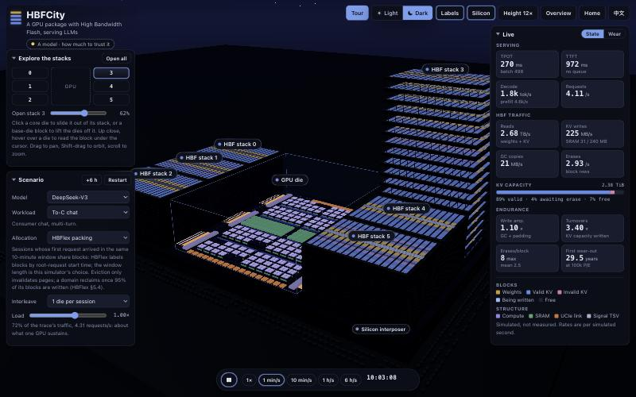
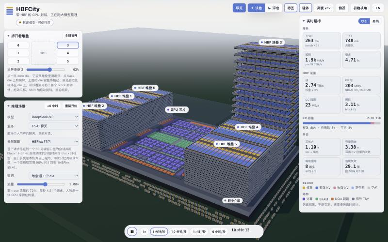
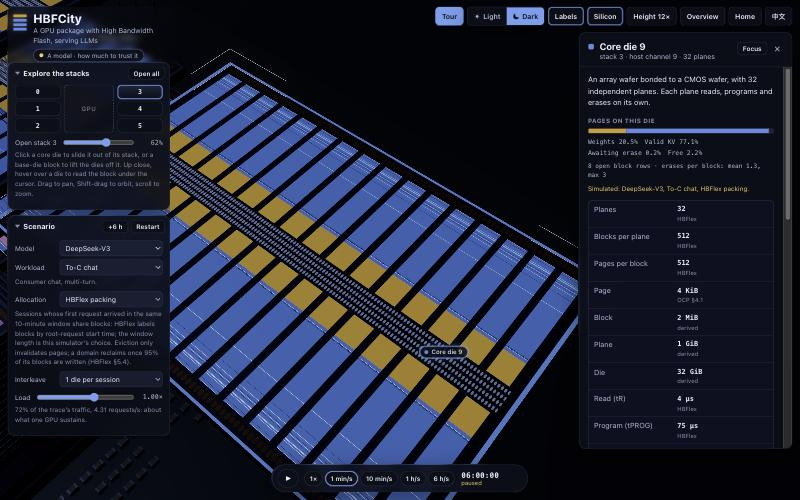
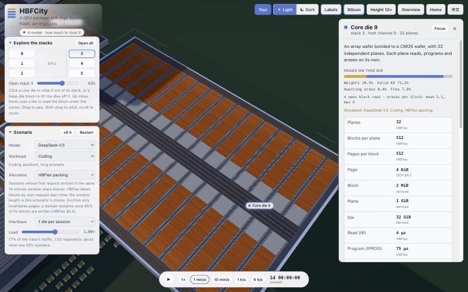
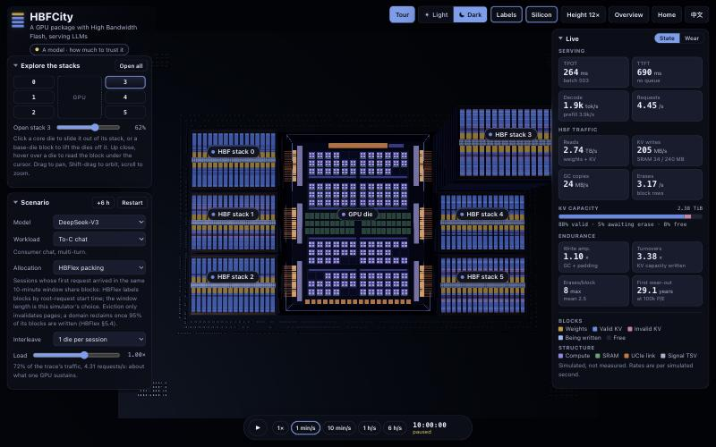

# HBFCity

**A GPU package with High Bandwidth Flash, drawn as a city you can open up.**

**Open it in a browser: <https://yisun219.github.io/hbf-city/>**
(中文界面: <https://yisun219.github.io/hbf-city/?lang=zh>). Nothing to install.

An explorable 3D model of an H200-class GPU and six HBF stacks on a silicon
interposer. Each stack is a base (logic) die and sixteen NAND core dies joined
by TSVs; open a stack to see its layers, slide a die out to see all 32 planes
and 16,384 blocks, or lift the core dies to see the base die's UCIe PHYs,
channel controllers and SRAM.



A serving simulator runs underneath: synthetic LLM sessions drawn from
production trace statistics are batched on the GPU, their KV cache is written
to HBF block by block, evicted, reclaimed and erased, and every one of the
1.57 million blocks on the package shows its live state or its wear. Hover
over a die up close to read the block under the cursor: its plane and block
number, what it holds, how many of its pages are still valid and how often it
has been erased.

**中文说明**：把一颗带 HBF 的 GPU 封装做成可探索的 3D 城市，直接用浏览器打开上面的网址即可，界面右上角可以切换中文 / English、浅色 / 深色。中间是 GPU，两侧各三个 HBF 堆叠；每个堆叠是一个 base die 加 16 层 NAND core die，用 TSV 连起来。可以把堆叠拆开看分层，把某一层 die 像抽屉一样拉出来看 32 个 plane、16,384 个 block，或把 core die 整体抬起来看 base die 上的 UCIe PHY、通道控制器和 SRAM。底下跑着一个 LLM serving 仿真：按生产 trace 的统计生成会话，做连续批处理，KV 按块写进 HBF、淘汰、回收、擦除；每个 block 实时显示状态或磨损，鼠标凑近 die 还能看到光标下那个 block 的编号、内容、有效页数和擦除次数。第一次来可以点「导览」，8 步走完整个结构和仿真。

| | |
|---|---|
|  |  |
|  |  |
|  |  |

## Using it

- **Tour** (top right, or `T`) walks through the package, a stack, a core die,
  the base die, serving traffic, the cache filling up and wear, in eight stops.
- **Light / Dark** switches the colour mode; by default it follows the
  operating system. **中文 / EN** switches the language.
- Click anything for its notes: what it is, its numbers, and the source of
  each number. **A model · how much to trust it** lists what is simplified.
- The scenario card on the left picks the model, workload, block policy,
  interleave width and load; the Live panel on the right shows serving,
  traffic, capacity and endurance as the simulation runs.
- Works best in a desktop browser with WebGL 2. Phones get a compact layout.

## Controls

| Input | Action |
|---|---|
| Drag | Pan |
| Shift-drag, Ctrl-drag or right-drag | Orbit |
| Wheel | Zoom toward the cursor |
| Click | Select (a core die slides out; a base-die part lifts the core dies) |
| Double-click | Focus the camera |
| Hover a die, up close | Read the block under the cursor |
| `T` | Start the tour (`←` `→` to step, `Esc` to leave) |
| `X` / `A` | Open or close the selected stack / all stacks |
| `1`–`6` | Go to stack 0–5 |
| `Space` | Play or pause the simulation |
| `W` | Block state / wear view |
| `H` / `O` | Home view / top-down overview |
| `N` / `L` / `B` / `V` | Light–dark / labels / GPU bulk silicon / true proportions |
| `Esc` | Deselect |

## Run it locally

```bash
npm install --legacy-peer-deps
npm run dev      # http://127.0.0.1:5181
```

```bash
npm test
npm run typecheck
npm run build    # static bundle in dist/
```

Every push to `main` rebuilds the site with GitHub Actions
(`.github/workflows/pages.yml`) and publishes it to GitHub Pages.

URL parameters, for links and screenshots: `lang=en|zh`,
`theme=light|dark`, `view=overview|stack`, `stack=0..5`, `open=0..1`,
`die=0..15`, `select=<component id>`, `focus=<component id>`, `scale=1..12`,
`labels=0|1`, `model=deepseek-v3|qwen3-235b|hunyuan3`,
`workload=toC|toB|coding|thinking`, `policy=hbflex|arrival`, `width=1|4|16`,
`load=<multiplier>`, `speed=<sim s per s>`, `play=0|1`,
`skip=<hours to simulate before the first frame>`, `blocks=state|wear`,
`tour=1..8`, and `settle=1` to skip animations. A link's `lang` and `theme`
apply to that visit only.

## Where the numbers come from

Every device number lives in `src/core/hbf-spec.ts` with its source, and the
inspector prints the source next to each fact.

| Quantity | Value | Source |
|---|---|---|
| Stacks per GPU | 6 | HBFlex (arXiv 2609.18675) |
| Core dies per stack | 16 | OCP HBF High-Level Base Die Specification v0.7.0, §4.1 |
| Host channels per stack | 16 × UCIe x64, 32 GT/s | OCP §4.5, Table 2 |
| Link bandwidth | 3,072 GB/s per stack (75% AXI efficiency) | OCP Table 2 |
| Footprint, height | ≈ 10.975 × 16 mm, 775 µm; UCIe bumps on a 10.975 mm edge | OCP §4.1, Fig. 37 |
| Planes × blocks × pages × page | 32 × 512 × 512 × 4 KiB → 512 GiB/stack | HBFlex; page size OCP §4.1 |
| tR, tPROG | 4 µs, 75 µs | HBFlex §6.1 (after FlashAccel) |
| Endurance | 100,000 P/E | HBFlex §3.3 |
| Base-die SRAM | 40 MB per stack | HBFlex §4.1 |
| Array-limited read | 512 planes × 4 KiB / 4 µs ≈ 524 GB/s | derived |

Floor plans inside the stack are not public. The core die follows the
published diagrams (FlashAccel Fig. 6c; "HBF Sucks" Fig. 2): signal TSVs in a
centre strip, power TSVs along the long edges, planes in two rows. The base
die follows OCP Fig. 1 functionally. The word-line staircases at the ends of
each plane are generic 3D-NAND structure, not taken from those figures. The
GPU follows the GH100 block diagram and is approximate.

## The serving simulator

`src/sim/` has no three.js in it. Each iteration decodes one token for every
running request and prefills up to 2,048 prompt tokens. Its time is the larger
of compute (2 × active parameters × tokens at half of an H100/H200's dense FP8
peak) and the busiest interleave domain's work: the reads of its share of the
weights and of its sessions' KV, its KV programs and leftover
garbage-collection work, added together because they share the same planes.

| Piece | What it does | Source |
|---|---|---|
| Models | DeepSeek-V3, Qwen3-235B-A22B, Hunyuan3; 8-bit weights and KV (one byte per element, as HBFlex assumes) rebuilt from their public configs (35,136 / 96,256 / 163,840 KV bytes per token) | Hugging Face configs |
| Workload | Synthetic sessions from statistics computed from four 2-hour production traces: To-C chat, To-B API, Coding, Thinking | Qwen-Bailian traces (Wang et al., arXiv 2506.02634) |
| Load | The default is the share of a trace one GPU sustains with HBFlex packing, with room to spare, from a small model of the iteration (batch by Little's law, length-biased contexts, the slowest domain, the prefill chunk on one die, GC). The tests run every model and workload at it for eight hours and require that no queue builds | this simulator |
| Writes | KV collects in base-die SRAM and is programmed a stripe at a time; one block number is used on all 32 planes of a die together, at one page number. A write the store cannot place yet stays in SRAM and is retried; no page is ever dropped | OCP §5.4, §5.7, §11.2.2 |
| Eviction | Least-recently-used sessions are evicted when valid KV passes 90% of capacity, down to 85% | HBFlex §5.4 (90%); 85% is this simulator's |
| Policies | **Arrival order, immediate reclaim**, a stand-in for the baseline HBFlex compares against (the paper does not define it), and **HBFlex lifetime packing, delayed reclaim**: blocks labelled by root-request start time (the 10-minute window is this simulator's choice), reclaimed when a domain is 95% written, fully stale blocks first and then the least-valid ones at least a quarter stale, with two blocks per domain kept for GC copies; a request whose interval has no open block shares the one with the closest label | HBFlex §5.4 |

Nothing here does wear leveling: free blocks are taken in queue order.
OCP §11.4 recommends enabling base-die or host-controlled wear leveling; the
simulator leaves it out, so the wear view and the "first wear-out" projection
show what wear looks like without it. Data refresh, which OCP §11.5 calls for
typically every 24–48 hours and after a product-specific number of reads, is
not simulated either, so weight blocks never wear here.

Simplifications that matter:

- Experts are routed uniformly, and with no HBM every iteration rereads all
  the weights it touches from flash: for DeepSeek-V3 that is nearly all of its
  670 GB once the batch passes a few hundred tokens.
- Compute counts 2 × active parameters per token and leaves attention FLOPs
  out; iterations stay bound by flash reads in every setting tried.
- A session's KV lives on one interleave domain (1, 4 or 16 dies). At one die
  per session a whole 2,048-token prefill chunk is programmed on one die, at
  1.75 GB/s, which is what limits prefill.
- Prefix reuse follows a session's turns, not hashes across sessions. A
  session that was evicted and comes back prefills, and writes, its whole
  context again: that raises turnovers, not write amplification.
- Eviction runs in 5% batches (90% down to 85%), so GC comes in bursts; the
  Live panel averages GC copies and erases over about five simulated minutes.
- Write amplification depends strongly on the interleave width: wider domains
  make coarser superblocks. "Near 4" for arrival order holds at one die per
  session; at 16 dies it is far higher.
- Base-die SRAM is not enforced. At 16 dies per session a request's open
  stripe is 2 MiB, and staged KV can exceed the package's 240 MB; the Live
  panel shows that in red rather than stalling.
- The "first wear-out" projection uses how fast the most-erased block's count
  has grown since the KV cache was written over twice, which leaves the first
  fill out, and appears two simulated hours after that.
- Estimates: 1.5 ms block erase, 0.5 ms launch overhead per iteration, 50%
  of dense FP8 peak, a 4,000-request queue limit.
- While the batch has room, a step never runs past the next arrival, so time
  to first token does not depend on playback speed. At high speed the loop
  still advances many identical iterations per step; every byte written and
  every erase is counted, but live numbers depend on frame timing, and only a
  fixed-length `run()` is exactly reproducible.

## Colours

Colour always means something. Blocks: weights amber, valid KV blue, KV still
being written light blue, invalid KV pink, free grey. Structure: compute
violet, SRAM aqua, UCIe and other links copper-orange, TSVs steel. Wear is a
single orange ramp (light to dark in light mode, dark to bright in dark mode).
The block colours were checked with a colour-vision validator in both modes:
every pair stays distinguishable for deuteranopia, protanopia and normal
vision.

## How much to trust this

- It is a model, not a die photo. Unpublished layouts are marked in the inspector.
- Heights are exaggerated 12× by default (`V` shows true proportions); circuit
  blocks are raised for legibility; opening a stack and sliding a die out are
  viewing aids.
- The GPU is drawn active side up; on a real package it is flip-chip mounted
  face down. Its bulk silicon is a translucent volume as tall as the stacks.
- OCP Table 3 counts 16 banks per channel; this model uses HBFlex's 32 planes
  per die. One host channel per die follows OCP §4.3; OCP Fig. 4 shows another
  arrangement.
- Block colours come from the simulator, not from a measurement, and its
  block unit is coarser than HBFlex's per-plane blocks, so its write
  amplification is not HBFlex's published number.

## How it is built

```text
src/
  core/    contracts, bus, registry, theme, i18n (English / 中文), HBF spec table
  sim/     models, workload, KV store and policies, serving loop (no three.js)
  world/   package, GPU, HBF stacks, die floor-plan shader, block atlas,
           sim view (store -> atlas), activity, flow pulses, sky
  engine/  renderer, camera, labels, picking
  ui/      HUD, inspector, simulation panels, tour, block tooltip, sourced notes
test/      arithmetic, geometry, atlas, block picking, store invariants,
           serving, translations
```

Stack: three.js r185, TypeScript, Vite. three.js is the only runtime
dependency. The world reads `SceneState`; the UI edits it and talks over the
bus. All 96 core dies are one instanced draw; their floor plans are drawn in a
fragment shader from a 1024 × 1536 atlas with one texel per NAND block, and
the block under the cursor is found with the same floor-plan arithmetic.

## Licence

Apache-2.0. Derived from PGSimCity (Copyright 2026 Nikolay Samokhvalov); see
[NOTICE](NOTICE). Not affiliated with the Open Compute Project, Sandisk,
SK hynix, NVIDIA or Electronic Arts.
